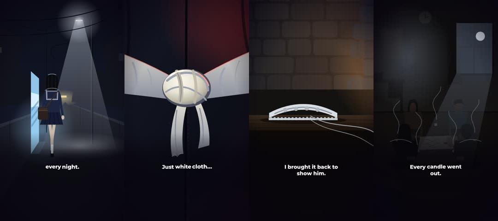

# kiamat

Kit visual untuk short horor 9:16 dengan gaya visual dari `anggara182/horrorluar`: vektor semi-realis, siluet berlapis di depan cahaya gradien, satu hero terang per shot, 100% SVG di Remotion.

**Hanya visual.** Cerita, topik, VO, dan pace akun ini ditentukan terpisah, tidak mengikuti horrorluar. Repo horrorluar tidak diubah.

## Isi
| Path | Isi |
|---|---|
| `VISUAL-STYLE.md` | Arahan visual lengkap: look, anggaran detail, komposisi, palet, karakter, teks, aturan teknis, alur kerja |
| `AGENT_BRIEF.md` | Brief untuk subagent yang menggambar satu set |
| `template/` | Kit Remotion + satu episode contoh (set EP15, caption placeholder) |
| `library/` | 249 komponen SVG EP02–EP20, `STYLE.md` per episode, thumbnail, `LIBRARY.md`, `catalog.json` |

## Mulai episode baru
1. Salin `template/` ke folder episode, lalu `npm install`.
2. Ganti `src/data/episode.json` dengan shot list episode baru (timing per shot + kata per kata dari VO akun ini).
3. Bagi jadi 2–3 set. Untuk tiap set, tulis `src/sets/<set>.tsx`, `src/shots/<OWNER>.tsx`, dan `src/art/<set>_*.tsx`, lalu daftarkan set dan shot di `src/comp/Bands.tsx` dan `src/shots/index.ts`. Cek `library/` dulu sebelum menggambar dari nol.
4. `node scripts/preview.mjs <set> <ids>` → review strip → perbaiki (minimal 3 loop).
5. `node scripts/bake.mjs`, lalu `node scripts/contact.mjs 0.6` untuk contact sheet seluruh episode.
6. Render penuh Remotion. Opsional: `scripts/finish.sh in.mp4 out.mp4` untuk grain + mux audio.

Cek cepat template: `cd template && npm install && npx tsc -p . && node scripts/preview.mjs village 1,11 0.5`.
